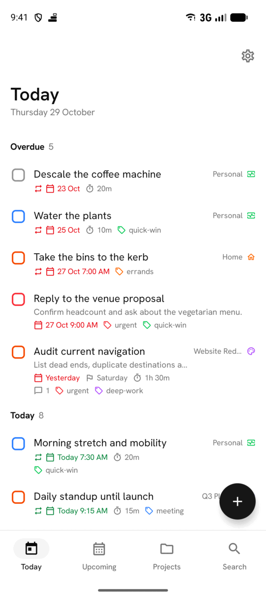
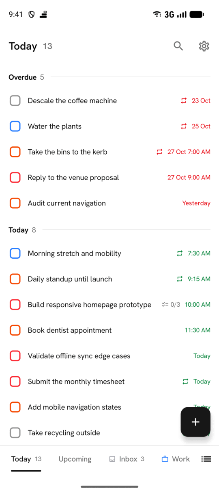
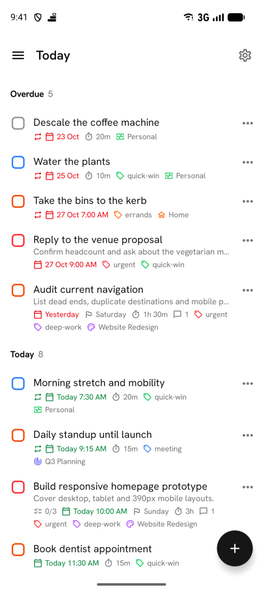
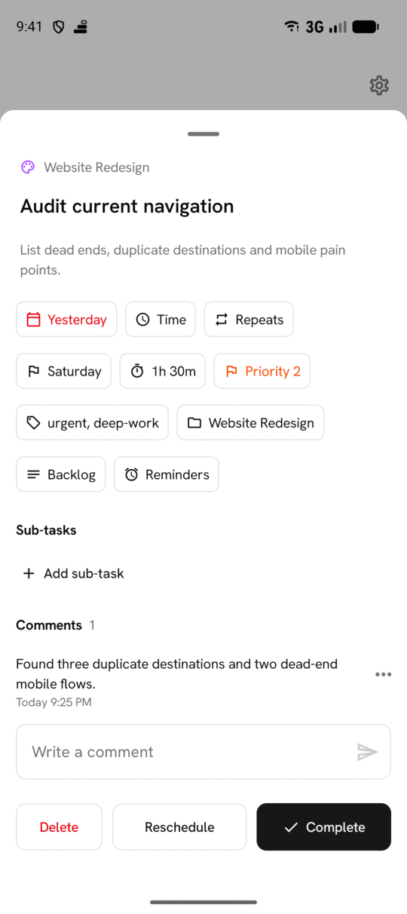
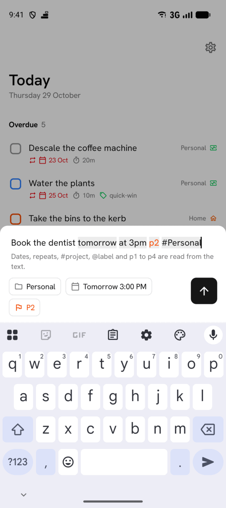
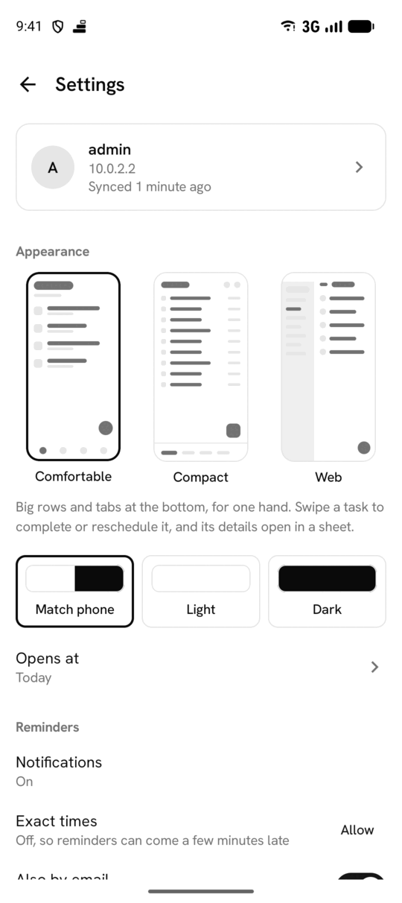

<h1 align="center">
  
  
</h1>

<p align="center"><em>Every goal starts with a next step.</em></p>

<p align="center">
  
  <a href="https://github.com/nojusmorkunas/conatus"></a>
  <a href="./LICENSE"></a>
</p>

Conatus for Android is the phone app for [Conatus](https://github.com/nojusmorkunas/conatus), the self-hosted task manager. Your tasks live on the phone and sync with your server in the background, so the app works offline and sends your changes once it has a connection. It also works without a server, as a task list that stays on the phone. It's free software under the GPL.

<p align="center">
  
  
  
</p>
<p align="center"><sub>The same Today in the three layouts: Comfortable, Compact and Web.</sub></p>

- Three layouts to choose from in Settings. Comfortable has big rows and tabs at the bottom, for one hand. Compact fits a task on each line and puts every list in a tab. Web looks and works like the web app.
- Today, Upcoming with a month calendar, projects with sections and sub-tasks, labels, search, Completed and Trash
- [Quick add](https://github.com/nojusmorkunas/conatus/blob/main/docs/natural-language.md) that reads dates, repeats, `p1`, `#project` and `@label` from the task name, as on the web, offline too
- Reminders as notifications, scheduled on the phone, so they arrive without a connection
- Recurring tasks, deadlines, durations, priorities and comments
- A long press selects tasks, to complete, move, reschedule or delete several at once
- A Today widget, a Quick Settings tile, launcher shortcuts, and text shared from other apps as a new task
- Sign-in with a password or through the browser, which covers single sign-on
- Light and dark themes, large text and TalkBack

<p align="center">
  
  
  
</p>

## Requirements

- Android 8.0 (API 26) or newer.
- To sync, a Conatus server running 1.3.2 or newer. 1.3.3 also revokes the phone's sign-in when you sign out of the app.
- The server needs HTTPS, unless it's on your own network. Plain http only works for a server on the local network, so a token never crosses the internet unencrypted.

## Install

There's no published release yet. To try the app, build it from source and install the APK with `adb install`.

## Build

You need JDK 21 and the Android SDK. Gradle finds the SDK through `sdk.dir` in `local.properties`, which Android Studio writes for you, or through `ANDROID_HOME`.

```bash
./gradlew assembleDebug
```

The APK is in `app/build/outputs/apk/debug/`. Three variants install side by side:

| Variant | Launcher name | What it's for |
|---|---|---|
| `release` | Conatus | The real app, shrunk with R8 and signed with your upload key ([how](./docs/release.md)) |
| `debug` | Debug | Development. It's debuggable, so it feels slower than it is |
| `preview` | Preview | The debug code shrunk with R8 and not debuggable, for judging how the app feels |

## Contributing

Report bugs and ideas in [Issues](https://github.com/nojusmorkunas/conatus-android/issues). See [`CONTRIBUTING.md`](./CONTRIBUTING.md) for running the app against a local server and the checks a change needs to pass.

## License

GPL-3.0. See [`LICENSE`](./LICENSE).
